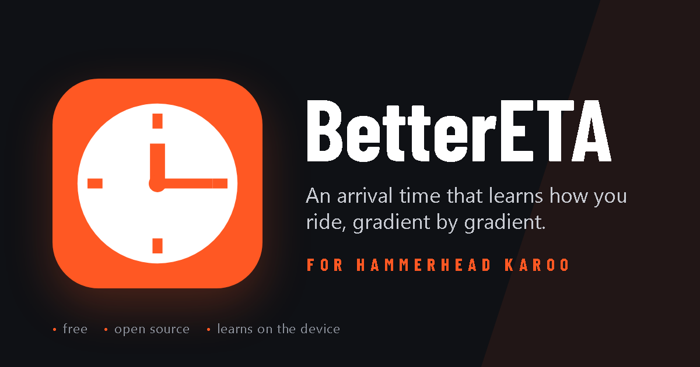
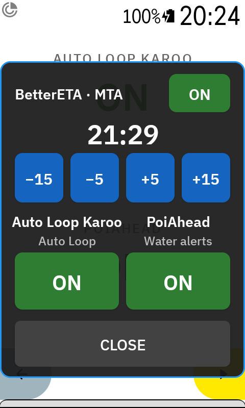
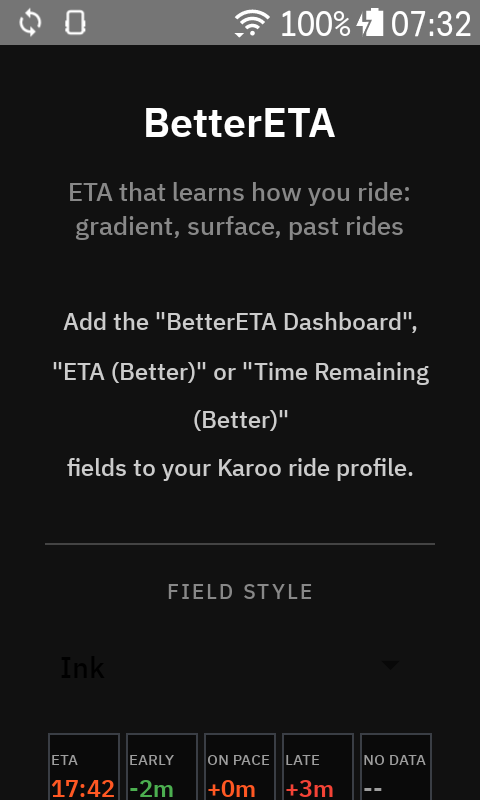
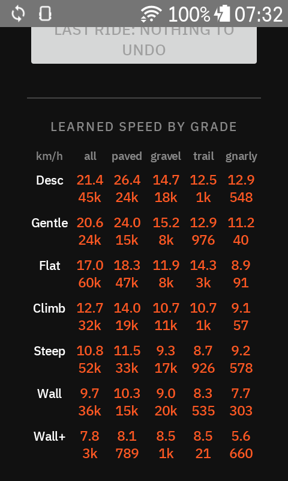

<picture>
  <source media="(prefers-color-scheme: dark)" srcset="https://gist.githubusercontent.com/anpaiss/78cf5eb76ad50594402b9778008a00a8/raw/BetterETA-card-dark.svg">
  
</picture>

# BetterETA

> **Beta** — install the APK from the [latest release](../../releases/latest/download/BetterETA.apk). Tested by one rider on one Karoo 3 for three months; read [Beta status](#beta-status) before trusting it on a ride that matters.

An arrival time for the Hammerhead Karoo that learns how **you** ride. Instead of dividing the distance left by an average speed, BetterETA looks at every stretch of the route still ahead, asks "how fast do I usually ride a climb like this, on a surface like this?" and adds up the answers. It learns from the rides already stored on your Karoo, keeps learning on every ride, and adapts to the shape you are in today.

## Why

The Karoo's own ETA takes the distance to the destination and your average speed so far. On a flat ride that works. On a ride that climbs 1000 m in the first half and descends in the second, the first half makes it far too pessimistic and the second half far too optimistic, and it only settles when the ride is almost over.

Over the eleven routed rides logged between September and October 2026, hilly mountain-bike loops of 20 to 40 km, the two estimates were judged the same way: once a minute, how far the predicted time to go was from the time really needed to the finish, as a share of that time.

| | Average error | Worst ride |
|---|---|---|
| Karoo native ETA | 44 % | 57 % |
| BetterETA | 10 % | 18 % |

BetterETA was closer on every one of those rides. On a route ridden before, the error sat between 3 and 7 %.

## How it works

**The route is cut into short stretches.** When the Karoo starts navigating a route, BetterETA takes the route's line and its elevation profile, smooths the elevation over 50 m to remove the noise, and splits the route into stretches with a gradient each. The time to go is the sum of the times of the stretches still ahead of you.

**A speed for every kind of stretch.** The extension keeps a table of your speeds: seven gradient bands, from steep descents to walls above 16 %, each split by surface, paved, gravel, trail and gnarly. A 6 % climb on tarmac and a 6 % climb on a root-strewn trail get their own speed. You can see the whole table in the app, with the number of seconds of riding behind every value.

**It starts from your past rides.** The Karoo keeps every ride it recorded. On first start, once you have granted the storage permission, BetterETA replays those rides into the table, the last twelve months by default: a year of riding takes about a minute and a half. From then on the table is already yours, and the first ride does not start from guesses.

**It keeps learning, slowly.** During a ride, every second spent moving forward on the route refines the table. The memory is long, about six hours of riding at each gradient, so one slow day with friends does not rewrite how you usually climb. Riding without a route counts too, for the gradient bands.

**It notices the shape you are in today.** Within a ride, a "day factor" compares how you are riding right now with how you usually ride, and scales the whole forecast. Tired legs, a headwind, a loaded bike, company that rides slower: after the first kilometre the forecast follows. The factor starts fresh on every ride.

**It remembers places.** Besides the table, BetterETA remembers how fast you actually rode each road or trail segment, in each direction, from the map data. When a route runs over a segment you have ridden before, that memory counts more than the table, and more with every pass. This is where the biggest gains come from: technical trails, villages, broken gravel, where the gradient alone does not tell how fast you go.

**Surface comes from the Karoo's own maps.** The offline maps on the Karoo carry the road surface and the mountain-bike difficulty of every path. BetterETA reads them directly, no network needed. Where no map covers the route it asks the OpenStreetMap servers instead, which needs a connection at the moment the route is loaded.

**Stops are not predicted.** The time to go is riding time. A twenty-minute coffee stop moves the arrival by twenty minutes, as it would in real life, and no estimate can know it in advance. Everything else follows from this: the arrival time shown is "now plus riding time", the pace against plan counts only time spent moving, and the margin against a mandatory arrival time shrinks while you stand still.

**Where you are on the route.** The position along the route comes from the GPS matched to the route line, with checks for the cases where that is ambiguous: out-and-back roads, loops that pass twice by the same spot, a long detour. When the Karoo reports you off route the estimate is paused; when it recalculates the route, the new route is taken and learning resumes on it.

**How sure it is.** Next to the time to go the extension shows a `±`: how far the estimate may be off, narrower on stretches it remembers, wider on stretches it has never seen.

## Data fields

Seven fields can be added to any ride page from the Karoo profile editor:

| Field | Shows |
|---|---|
| **BetterETA Dashboard** | A whole page: the arrival time, and the time to go with its uncertainty. Once a mandatory arrival time is set, the arrival row also shows it with the margin, and the page takes the colour of the margin |
| **ETA (Better)** | The arrival time only |
| **Time Remaining (Better)** | The time to go only, with the uncertainty in the label |
| **Pace vs Plan** | Riding time against the first estimate of the ride: `+4m` in red means you are arriving four minutes later than planned, `-4m` in green four minutes earlier |
| **Arrival Margin (MTA)** | The mandatory arrival time and the minutes of slack against it: `+12m` AHEAD in green, `-5m` LATE in red |
| **Distance to Farthest Point** | Distance left to the point of the route farthest from the start, the turnaround of an out-and-back |
| **Switches** | The mandatory arrival time; a tap opens the Switches popup, see below |

The dashboard draws its numbers as large as the page allows, in the same condensed font as the BigFields extension. The Karoo draws its turn-by-turn banner over the bottom of the screen, so while a route is loaded the dashboard leaves that band free. Fields redraw only when their text changes and at most every few seconds: on the Karoo's screen every redraw costs battery.

Five looks are available in the app, from the plain Karoo style to coloured tiles; the app shows a preview of each.

## Mandatory arrival time

Some rides have a deadline: the last cable car, dinner, the train home. When a recording starts with a route loaded, a popup asks for a mandatory arrival time, preset to the estimated arrival rounded up to the quarter hour. SET it or DISMISS it; the popup closes by itself after 45 s with no time set. It is asked once per ride.

<table>
  <tr>
    <td></td>
    <td></td>
    <td></td>
  </tr>
  <tr>
    <td>MTA on, not set yet</td>
    <td>Set with one tap on +5</td>
    <td>MTA off</td>
  </tr>
</table>

From then on the margin against that time is on the dashboard and in the Arrival Margin field, recomputed every second, stops included. The first time the margin turns negative the Karoo shows an alert for 30 s; it is silenced while the estimate is approximate, off route or rejoining, unless you are more than ten minutes late.

To move the time during the ride, say after a long stop, tap the **Switches** field: the popup has the time with −15 / −5 / +5 / +15 buttons, and an ON / OFF switch. OFF clears the time, silences the alert and skips the popup on the next rides until you switch it back on. The same popup carries the switches of the other extensions by the same author that are installed, such as Auto Loop or the water alerts of PoiAhead, so one field is enough for all of them.

## Install

1. Download [`BetterETA.apk`](../../releases/latest/download/BetterETA.apk) from the latest release.
2. Sideload it onto the Karoo, for example with `adb install -r BetterETA.apk`, or copy it to the device and open it there.
3. Open **BetterETA** from the app list and grant the two permissions from the app page:
   - **Allow reading offline maps**, the storage permission. BetterETA needs it to read the Karoo's maps for the surface and the recorded rides for the first learning. Granting it restarts the extension, and the import of your past rides starts by itself about twenty seconds later; the app page shows how many rides it found.
   - **Allow popup**, the "draw over other apps" permission, for the mandatory arrival time popup and the Switches popup. Without it no popup is shown and the fields still work.
4. In the Karoo profile editor, add the fields you want to a ride page: the **BetterETA Dashboard** alone on a page, or the single fields next to native ones.

It is not on the Hammerhead app store. New versions install over the old one with the same command; the learned table, the memory and the settings are kept. The import of past rides runs only while the Karoo is not recording: if you install on the trailhead, it waits for the end of the ride.

## The app page

Besides the field style and the permissions, the app page has:

- **Ride history**: the window of past rides to learn from (3, 6, 12 or 24 months, or all), a button to import rides recorded since the last import, and one to rebuild the whole table from history alone, which forgets everything learned live.
- **Last ride: don't count it**: undoes the learning of the last recording, for the day the Karoo was left recording in the car or a ride that is not representative. It restores the table, the memory and the comparison history to the state before that ride.
- **Learned speed by grade**: the table itself, km/h per gradient band and surface, with the amount of riding behind each value.
- **ETA vs Karoo**: for the last twenty routed rides, how far each estimate was from the truth, judged at the end of the ride as described above.

## Beta status

What BetterETA has been tested on, honestly:

- One rider, one Karoo 3, one e-mountain bike, three months of rides in the Italian Alps, 20 to 40 km with 500 to 1500 m of climbing. Nothing is specific to e-bikes except the guesses used for a gradient band before any ride fills it, and after the first import every band is filled from your own rides.
- The Karoo 2 is supported by the SDK but untested. The screen is the same size; the maps are read the same way.
- Routes need an elevation profile, as routes planned in Komoot, Strava or the Hammerhead dashboard have. Navigating to a dropped pin gives no elevations: the gradient is then unknown and the estimate uses your flat speeds.
- When you skip a loop of the route, riding back on a road that the route uses twice, the position can take several minutes to catch up, and the estimate is wrong meanwhile. This has been seen once in three months, it cost seven minutes of wrong ETA, and the fix for it has not been exercised on the road yet.
- The comparison with the Karoo's ETA is honest only when you ride the route to its end. If you load a long route and ride home halfway, the ride's row in the ETA vs Karoo list is meaningless, for both estimates.

Bug reports and rides that went wrong are welcome as [issues](../../issues). Please include the Karoo model, the Karoo OS version and, if you can, the log file: `Android/data/com.anpaiss.bettereta/files/better_eta.log` on the Karoo's storage, readable over USB.

## Privacy

Everything runs and stays on the Karoo: the table, the memory of places, the comparison history, the logs. There is no account and no server of mine. The only network use is the fallback for the surface, a request to the public OpenStreetMap Overpass servers with the coordinates of the stretches of route that the offline maps do not cover; with the maps installed it never happens.

## For developers

The repository holds two modules: `app`, the BetterETA extension, and `eta-core`, the route, position and speed-model code shared with `boschrange`, an experimental battery-range extension for Bosch e-bikes that is not released.

- Build: `./gradlew :app:assembleDebug`; tests: `./gradlew :eta-core:testDebugUnitTest :app:testDebugUnitTest` (about 200 tests on the model, the ETA engine, the position on the route and a replay of recorded rides). The `karoo-ext` SDK and the shared [KarooSwitches](https://github.com/anpaiss/KarooSwitches) library come from GitHub Packages, which needs `gpr.user` / `gpr.key` in `~/.gradle/gradle.properties` (a token with `read:packages`).
- CI: every push runs the tests and builds a debug APK. A tag `vX.Y` builds the release APK, signed with the repository secrets `KEYSTORE_BASE64`, `KEYSTORE_PASSWORD`, `KEY_ALIAS`, `KEY_PASSWORD`, and attaches it to a GitHub release as `BetterETA.apk` together with the Karoo extension manifest. `GPR_TOKEN` is the token the workflow uses for GitHub Packages.
- Diagnostics on the device: `better_eta.log` (human-readable, three rotated generations) and `better_eta_samples.csv` (one row per second while recording, with every quantity next to the Karoo's own) in `Android/data/com.anpaiss.bettereta/files/`. The `tools/` folder has the Python scripts that replay those files through the model, which is how every change to the model is judged before it ships.

## License

MIT, see [LICENSE](LICENSE). The bundled Barlow Condensed font is licensed under the SIL Open Font License 1.1 ([`app/src/main/assets/OFL-BarlowCondensed.txt`](app/src/main/assets/OFL-BarlowCondensed.txt)).
