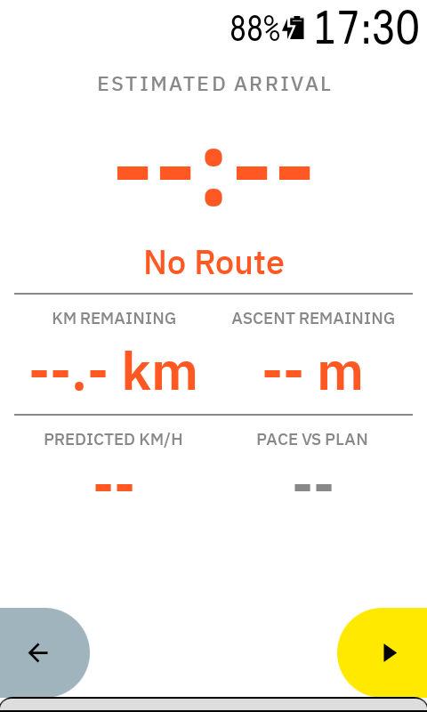
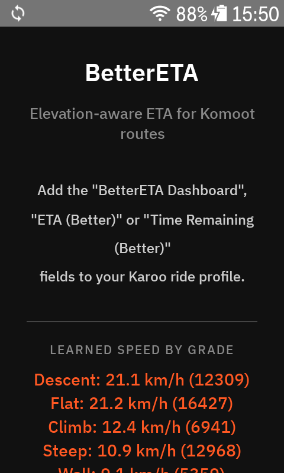
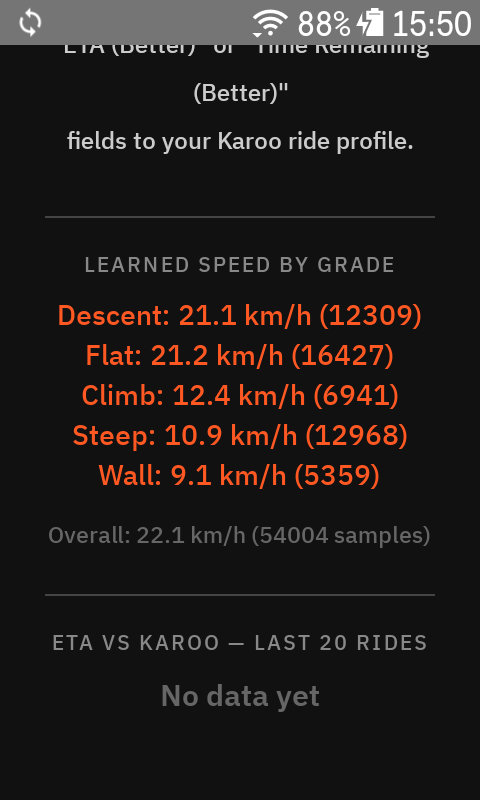

# BetterETA

A [Hammerhead Karoo 3](https://www.hammerhead.io/karoo) extension that computes a **smarter ETA for the route you are navigating**: it learns how fast *you* ride at each gradient and uses that model to estimate the time for every remaining segment of the route — instead of a simple distance/average-speed guess. The learning is bike-agnostic; only the cold-start fallback factors (used until a gradient bucket has real samples) are tuned for e-bikes.

---

## Data Fields

The extension registers five data fields you can add to any ride profile:

| Field | Content |
|---|---|
| **BetterETA Dashboard** | Full-page view, three rows: arrival time; time to go with the estimate's uncertainty (`TO GO ±8m`); pace vs plan, or the mandatory arrival time and margin once one is set. The page colour follows the number in the third row: the MTA margin when one is set, pace vs plan otherwise |
| **ETA (Better)** | Arrival time only (HH:mm) |
| **Time Remaining (Better)** | Time remaining only (Xh Ym) |
| **Distance to Farthest Point** | Distance left to the point geographically farthest from the start (the turnaround of an out-and-back) |
| **Arrival Margin (MTA)** | The mandatory arrival time set at ride start and the minutes of slack against it (`+12m` on green with AHEAD, `-5m` on red with LATE; `--:--` / `--` when none is set) |
| **Pace vs Plan** | Riding time against the first estimate of the ride (`+4m` = arriving later than planned, red; `-4m` green) |

Every dashboard row is label on the left, value on the right, both auto-sized to fill the row, like the single-value fields. The single-value fields carry the same rows on their own: ETA, time to go (with the `±` in its label), pace vs plan, MTA and margin. They size their text to the cell the Karoo gives them, so the same field reads large on a two-field page and smaller on a six-field page; below about a sixth of the page the two-line label reaches its minimum size first. The third row reads `PACE VS PLAN` until a mandatory arrival time is set, then `MTA 19:45` with `AHEAD`/`LATE` and the margin in minutes: same two text views, only the text changes, because the Karoo's renderer ignores visibility switches. The Karoo draws its turn-by-turn "next cue" ticket over the bottom of the screen without notifying extensions, so the bottom band of the page is left empty.

The `±` next to the time to go is how far the estimate may be off: a share of the time left (17 %), narrowed by the part of the route covered by per-way memory (down to 11 %), widened by the part on the physics fallback (up to +10 %) and by a rough `~` estimate (+10 %), never under one minute. Calibrated on the production ETA error of the logged rides (06/09/2026: 68th percentile 12 % with memory on 60–90 % of the route); provisional until more rides are logged.

---

## How It Works

### Adaptive speed model
- Seven gradient buckets: descent (< -6%), gentle descent (-6..-2%), flat (-2..+2%), climb (+2..+6%), steep (+6..+10%), wall (+10..+16%), extreme wall (> +16%; split on 19/09 after a ride with 2 km at 18-21% ridden at 7.7 km/h against a single "> 10%" bucket at 9.0). Until 05/09 there were five, with "flat" spanning -5..+2%: on that day's ride the -6..-2% band averaged 15.5 km/h and 0..+2% averaged 9.9, and one bucket described neither. Saved five- and six-bucket models are migrated on load by splitting the old flat bucket and the old wall; the bucket born from the wall split starts with at most 600 samples, because with its parent's real count (tens of thousands against a 6-hour window) it would never move away from the copied speed.
- Two time scales. Each bucket keeps a long exponential moving average of your observed speed (cumulative mean first, then an EMA with an equivalent window of **~6 hours of riding at that gradient**): that is how you usually ride, and one slow ride barely moves it. On top of it a **day factor** — the ratio of observed to expected speed, learned during the current ride (15-minute window; prior at 1.0 worth ~7 minutes for the global factor, 2 minutes for the per-bucket ones) — scales every prediction. It is one global number plus one per bucket: the global one learns from every sample at any gradient, so ten slow minutes of climbing already lower the flat and the descent still ahead; the per-bucket one takes over as its bucket sees its own samples (the scaling is not uniform: on 05/09 descents ran at 0.55 of the base, climbs at 0.8). The factor restarts at 1 with every new ride. Until 05/09 the 20-minute EMA was the only memory, so whoever rode last dictated the next start.
- The constants were tuned by replaying the recorded sample CSVs through candidate models (`tools/replay_model.py`): on the 05/09 ride the ETA error was 20% with the 20-minute buckets alone, 16% with a global factor, 9–11% with per-bucket factors; the optimum is broad, so 900/120/120 was chosen. Every future ride's CSV can be replayed the same way.
- `tools/replay_factor.py` replays the same CSVs with the device's real gradient × surface base (the model snapshot is read from the day's log) and compares day-factor variants with signed metrics, including a `--carry` mode that walks the rides in order and judges each one before learning it. On the September rides: a per-surface day factor brought no mean gain (not implemented); a slower global prior (120 → 400) kept the mean error and cut the early over-reaction from −13% to −5% (implemented on 17/09); a seventh gradient bucket left the mean at 6.0% and helps only on stretches above 16%. The largest finding was about the base, not the factor: the surface buckets rebuilt from twelve months of FIT history were 15–30% slow for solo riding, and re-learning them from the live rides took the carried-over error from 8.5% to 5.9%.
- **Open question, to be settled with more rides: is the global day factor worth keeping?** Replayed on a sound base, the day factor as a whole is worth 0.3–0.4 points of mean ETA error on ordinary solo rides (6.0% against 6.4% with no factor, within the noise of six rides) and about 6 points on the one anomalous ride recorded so far (10.7% against 16.4%): it is insurance for unusual days. Nearly all of that comes from the per-bucket factors. The global factor alone does not beat having none, and it is behind both misbehaviours seen on the road: an optimistic ETA after a fast paved climb (its pace carried over to a gravel climb) and a pessimistic one on a descent after a slow climb. Candidates, in order: per-bucket factors only (estimated cost about 1 point on anomalous rides, none elsewhere; buckets not yet ridden could inherit from neighbouring gradients rather than from everything); a much slower global prior (~1000 samples); a global factor split between climbing and descending. Decision rule: at least 10–12 recorded rides with 2–3 anomalous ones; switch if a variant beats production by ≥ 0.5 points on average, loses no more than 1.5 points on any anomalous ride, and improves the signed extreme of the first 15 minutes. The comparison is one command — `python tools/replay_factor.py --carry --start nosurf --logs "logs/*.log" --from <day> <csv…>`, rows `B base 6h pg400` (production), `solo per bucket`, `solo globale pg400`, `no factor base 6h`. The replay leaves out the per-way memory, which in production covers 60–90% of a route and is scaled by the same factor, so a change must also be confirmed on the end-of-ride comparison of a few real rides.
- The model is persisted across rides and shown in the extension's app page.
- Samples are taken only while actually progressing along the route (at least 20 m of net advance over the last minute, on top of the 0.5 m/s floor). Speed alone is not enough: a device left recording indoors reports GPS-jitter speeds around 1 m/s for hours and would drag the flat bucket down with it.
- Rides without a route learn too: the gradient buckets (surface unknown) and the day factor, gated by the GPS alone — net displacement over the last minute of at least 20 m and no more than twice the distance integrated from speed, which rejects both the jitter of a fix at rest and a fix that jumps. No sample CSV rows and no per-way memory without a route.
- Buckets without enough samples fall back to observed flat speed × a per-gradient factor (these factors are the only e-bike-specific tuning; on a regular bike the model simply learns different bucket speeds).

### Ride history import

The Karoo keeps every ride's FIT file in `/sdcard/FitFiles`, and a FIT record carries the same four things the model consumes live: position, speed, altitude, distance. So on start (20 s after, never while recording) the extension replays every FIT it has not seen yet into the model, as if it had been on the bike that day: gradient buckets and per-surface buckets, the physics shadow, the per-way memory. Surface comes from the offline maps as usual. Three differences from live are deliberate: gradient is derived from the FIT altitude smoothed over 50 m rather than taken from the Karoo; way passes are stored at day factor 1, the factor of that day being unknown (the last-three-passes average absorbs a bad day); and the guard is the GPS one from free rides, so a device left recording indoors contributes nothing. Rides shorter than 10 km or with fewer than 300 accepted samples are skipped: tests, indoor recordings, rides to the bakery. The app page chooses the window (last 3, 6, 12 or 24 months, or everything; default 12), has a button to import new files, and one to rebuild the learned model from history alone — buckets, per-way memory and the list of examined files are cleared first, so after a filter change or a polluted day the base is nothing but real riding. A minimal FIT reader (`record` messages only) does the parsing; the list of examined files lives in `imported_fits.txt`; one `HIST` log line per ride shows date, km, accepted samples, way passes, milliseconds and km per surface class, and the last line the total time. On the Karoo 3, twelve months (28 real rides, 787 km, 186k samples) took ten minutes the first time, most of it writing the way cache after every ride; the cache is now written once at the end.

### Per-way memory

Above the buckets sits a memory of how fast you actually rode each OpenStreetMap way, in each direction. While riding on the route, every continuous stretch on the same (way, direction) of at least 50 m and 10 s is recorded as a pass: its average speed divided by the day factor of the moment, i.e. a base speed, with the last three passes kept. A pass interrupted by a stop is still one pass: the Karoo's auto-pause closes the stretch in progress, so fragments of the same (way, direction) closed within 30 minutes are merged into the last pass as total distance over total time, instead of each taking one of the three slots (before 19/09 almost one recorded pass in five was such a fragment, and a 28-second fragment weighed as much as a four-minute pass). The memory and the model's base are coupled through the day factor: a pass is stored as observed speed divided by the factor of the moment, so whenever the base is changed by hand or rebuilt, the stored passes no longer mean the same thing. It happened on 17/09 — the base was corrected, the memory was not, and a well-known route came out 14% pessimistic three days later; the observed speeds of the very same passes predicted that ride within 1%. `tools/rebuild_way_memory.py` rebuilds the live passes from the `WAY` log lines (observed speed before the change, logged base after it, fragments merged) and has a `--check` mode that scores the rebuilt memory against a later ride. When a route later runs over a way you have ridden in that direction, the remembered base speed, rescaled by today's day factor, blends into the bucket prediction weighted by the number of passes (n/(n+1): half after one pass, three quarters after three). Direction comes from the order of the way's points along the route, and segments are never merged across ways. The memory lives in `way_speeds.txt`, capped at 5000 entries, and the ETA log line reports the share of the remaining distance it covers (`mem=`). It pays off where gradient does not explain speed — technical trails, villages, broken gravel — and only from the second pass on the same stretch.

### Physics model (shadow, under evaluation)
A second speed model runs alongside the learned buckets and produces a shadow ETA that is **never shown in-ride**. It uses the cycling power equation `P = ½·CdA·ρ·v³ + m·g·(s + Crr)·v`, but the power is not measured: it is inferred from the speed and gradient we already sample every second, so on an e-bike it already contains the motor. Two averages are kept, split at the ~25 km/h assist cutoff, so the pedelec's piecewise behaviour falls out of the data without any "is it an e-bike" setting. Mass and CdA are fitted parameters and cancel within a regime. Descents stay with the learned buckets — the equation returns a coasting speed there, and riders brake.

In the shadow engine the physics answers every segment it can (climbs and flats) and the buckets only the rest, so the two ETAs differ on real rides. Until 12/09/2026 it only replaced the cold-start factors at the bottom of the cascade, a rung a model rebuilt from the FIT history never reaches — every ride scored `phys +0` and nothing was learned. The shadow ETA is judged at the end of every ride by the same harness as the Karoo comparison below, and the app page shows the result. The promotion criterion was fixed before any data was collected: at least 5 rides, mean error at least 2 pp lower than the buckets, never more than 3 pp worse on a single ride.

### Route & position tracking

- **Off route.** When the Karoo reports `ON_ROUTE = 0`, dead reckoning is frozen. If the Karoo is rerouting, the fields show an approximate ETA marked `~`: the rejoin detour it proposes (`rejoinDistance`, no elevation, so at the model's flat speed) plus the route from the rejoin point, which is the Karoo's own along-route position. Without a rejoin the fields say "Off route". Freezing matters: advancing along the route while riding elsewhere produced 32 minutes of confident, wrong ETA (05/09: parking 310 m from the start but a few metres from km 7.6 of the loop). When the Karoo reports the route again, the position is re-anchored to the waypoint near the fix that is coherent with the Karoo's own along-route position (`routeDistance − DISTANCE_TO_DESTINATION`), and the pace baseline restarts. The same Karoo position breaks ties in the initial localisation, when the estimate is still 0.
- **Rejoin stubs.** During a route the Karoo answers a detour with a `NavigatingToDestination` whose polyline is just the way back to the route, a few waypoints long. Taken as a route it reset position, pace baseline and the end-of-ride comparison (06/09); such stubs — under 3 km while a route is loaded — are now ignored, and a destination change within five minutes of the arrival scores the comparison before discarding it. The filter applies only while the route in memory is a planned route: when navigating to a destination, a recalculated route shorter than 3 km is the real route.
- **Initial anchoring.** The Karoo's position arrives about a minute after the start, so the first anchoring has to do without it. Within 400 m of the route start the rider is anchored at the start, even if a closer waypoint exists (a loop passing back by the parking); farther away the pipeline waits up to a minute for the Karoo's position before anchoring to an inner point, showing the whole-route ETA as `~` meanwhile. When the first Karoo position arrives it is checked against the anchoring, and the position moves only if the alternative is more coherent with it.
- Routes arrive from the Karoo navigation state (`NavigatingRoute` / `NavigatingToDestination`); coordinate and elevation polylines are decoded, elevations smoothed over a 50 m window, and waypoints compressed into (distance, gradient) segments.
- Position on the route = **dead reckoning** (speed × time) corrected every second by **GPS snap**, searching a window centred on the estimated position and picking the candidate most coherent with it — so out-and-back roads and loops don't teleport the rider to the wrong branch.
- If the fix stays outside the local window (route loaded mid-ride, long detour), a **global rescue** re-anchors the position — but only after consecutive coherent proposals *and* only if the implied jump is physically plausible (elapsed wall-clock time × max credible speed). A 32 km "jump" after 40 seconds off-track gets rejected; a 2.5 km jump after a 20-minute stop with the Karoo auto-paused gets accepted.
- If GPS goes silent for more than 10 s the extension keeps dead reckoning and flags the state.
- Remaining ascent sums **every** positive elevation delta of the segments ahead. The 50 m elevation smoothing already removes the polyline noise, so the old "count only segments at ≥ 1%" rule was double protection that quietly dropped every false flat and under-reported the climbing left. Both figures go to the sample log, next to the Karoo's own `ASCENT_REMAINING` and its climb list.

### Display refresh
The engine recomputes once a second, but each field redraws only when the text it shows actually changes, only while it is on the ride page the user is looking at, and at most once per its own interval (20 s for the time fields, 10 s for the distance, 5 s for the dashboard). On e-ink every redraw costs battery and leaves ghosting. The visibility gate fails open: if the active page is unknown, everything draws — a gate that wrongly filtered a field out would freeze it for a whole ride and fail silently.

### Mandatory time of arrival (MTA)

When recording starts with a route loaded (or a route is loaded while already recording), a popup asks for a mandatory arrival time: two wheels, hours and minutes in 15-minute steps, preset to the ETA rounded up to the quarter hour — the popup waits up to 90 s for the GPS to anchor the position on the route, so the preset is the arrival from where you are rather than for the whole route; starting off route it waits up to two more minutes for the rejoin estimate (the Karoo publishes the distance to destination about three minutes into navigation), then falls back on the Karoo's native ETA and only last on "now + 1 h" — with **SET** and **DISMISS** (auto-dismiss after 45 s = no MTA). It is asked once per route — never again on the Karoo's pause/resume churn or after the extension restarts mid-ride, but the same route on a later day asks again. The MTA is the rider's decision, not the route's: a recalculation keeps it silently, a new destination (a detour, a search for a fountain) keeps it and re-asks with the current time preset, so stretching or shortening by a quarter hour is one tap and DISMISS leaves it unchanged. A stop of five minutes or more re-asks the same way on resume, since a long stop is when the arrival time changes. It is cleared only when a new ride starts.

The margin is `MTA − (now + time remaining)`, recomputed every second **including while paused**: the ETA is moving time, so a stop that drags on eats the margin exactly as it eats the clock. The dashboard shows MTA and margin in its third row while an MTA is set (the label reads AHEAD / LATE, the value is coloured in every style but Karoo standard); the standalone field shows the same. An in-ride alert (shown for 30 s) fires the first time the margin turns negative and re-arms only once it climbs back above two minutes. It stays quiet for 60 s after a SET, while the MTA popup is on screen (it would land under the overlay; it fires when the popup closes), and on approximate "~" estimates — off route, rejoining, not yet located — unless the margin is more than ten minutes negative: a rejoin estimate 47 s over the MTA is noise, an hour off route that costs 23 minutes is not.

The popup is an overlay window, so it needs the "draw over other apps" permission: grant it from the app page (**Allow popup**). Without it no popup is shown and the log says so.

### Surface classification

Each waypoint is classified **paved / gravel / trail / gnarly** from the OpenStreetMap ways along the route. Gnarly comes first: the Karoo's maps carry their own `mtb_difficulty=1..5` tag, the one that draws trail difficulty on the map with the ski-run scale (1 purple = unpaved road open to vehicles, 2 green = easy, 3 blue = intermediate, 4 black = difficult, 5 dark red = extreme). 3 or above makes the way gnarly whatever its surface says (the only singletrack of the 29/08 ride is a 3, and 4–5 barely exist around here: 2 ways out of 928); from OSM directly, `mtb:scale` 2 or above. Then a declared paved surface, then `tracktype=*` (grade1 paved, grade2–3 gravel, grade4–5 trail — on a track it outranks the material: `ground` with grade2 is a compact forest road), then the material (`surface=*`), then a low mtb difficulty (1–2: gravel on a track, trail on a path — the green lines are mostly forest roads), then `highway=*` as a proxy (path and bridleway are trail, track is gravel). The speed model keeps per-surface gradient buckets on top of the global ones, so the same 6 % climb on tarmac, on a forest road and on a root-strewn trail get their own learned speeds once each has a few samples. Until 05/09 there were two classes, and "unpaved" averaged the forest road with the trail.

The ways come from the **Karoo's own offline maps** first: the Mapsforge files in `/sdcard/offline/maps` carry the OSM tags, and the extension reads the zoom-16 tiles around the route's sample points, no network needed (same technique as karoo-routegraph, which ships in the Hammerhead extension library). That requires `targetSdk 28` (legacy external storage) and both storage permissions granted from the app page — the map files are readable only through the `sdcard_rw` group, which only the write permission grants. Mapsforge ways carry no OSM id, so the extension uses a stable hash of the geometry; a map update simply retires those cache and per-way memory entries. If the permission is missing, no map covers the area, or the read fails, the classification falls back to the Overpass API in a 25 m corridor. The app page runs a probe read around your last GPS position and reports the ways found per class.

The cache is **geographic, not per route**: it stores the fetched ways (geometry + surface) and the stretches of route they were fetched for. A new route is first matched against every cached way; only the stretches never queried go to Overpass, as one request. So a recalculated polyline, or a new route that shares a climb with an old one, reuses everything already known and, when offline, only the genuinely new stretch stays unknown (the classification is then marked partial and retried when the Karoo re-emits the route). Oldest fetches are dropped past ~200k geometry points (a few MB).

Overpass, when used, needs connectivity at route load (Wi-Fi or phone tethering); nothing in the ride depends on it afterwards.

### Pace vs plan
At the first valid ETA of the ride (with GPS locked) the predicted riding time is frozen as a baseline. From then on the dashboard shows the delta between current prediction and baseline, **counting moving time only** — stops do not move it. Green = ahead of plan, red = behind.

### ETA quality tracking (vs the Karoo's native ETA)
Once per minute the extension samples its own remaining-time prediction alongside the Karoo's native `TIME_TO_DESTINATION`. When the route is completed, every sample is judged against the moving time that was actually needed from that point to the finish. The result — how many percentage points of error BetterETA saved (or added) compared to the stock ETA, and how the shadow physics model would have done on the same samples — is stored per ride. The extension's app page shows the averages and the last 20 rides.

---

## Requirements

- Hammerhead Karoo 3 (Hardware ID: k24)
- Karoo firmware with extension support

Two RemoteViews details learned on the Karoo 3: the ride app ignores `setViewVisibility` and `setTextViewTextSize`, so a view that needs a different shape has to switch to a different layout resource; and after several rapid reinstalls the ride app may stop re-attaching the extension's views (it keeps showing the last picture) — a reboot fixes it.
- A route with elevation data (e.g. Komoot) for ascent-aware estimates; routes without elevation still get distance-based ETA

---

## Installation

Build and install via ADB:

```bash
./gradlew :app:assembleDebug
adb install -r app/build/outputs/apk/debug/app-debug.apk
```

Then add the BetterETA fields to a ride profile from the Karoo page editor.

---

## Sharing ride data with the developer

Recorded rides are what the model is tuned on, and a ride by someone else is worth as much as one of mine. Nothing leaves the device by itself: the app page has an **Export share file** button that writes `better_eta_share.csv` next to the sample log, and sending it is a separate, deliberate step (adb pull or a file manager for now).

The export keeps what the replay tools read — per-second speed, gradient, surface, position along the route, our and the Karoo's estimates, the day factor's margin — and drops what says who and when: route names become an 8-hex-digit tag (same route, same tag), the marker timestamp becomes a ride ordinal (one ride per calendar day, as the tools count it), `t_ms` restarts from zero at every ride, free-text `#` notes are dropped. Verified on my own rides: `tools/replay_model.py` gives identical figures on the exported file and on the original. The file is pseudonymous, not anonymous: the gradient/speed profile still describes the route and the rider, and the app says so next to the button.

Tester files have no device logs, so they are replayed with `python tools/replay_factor.py --carry better_eta_share.csv`: the base starts empty and every ride is judged before being learned.

## Releases & CI

Every push runs the unit tests and builds a debug APK (downloadable from the workflow run). Pushing a tag `vX.Y` builds a **signed** release APK and attaches it, together with the Karoo extension manifest, to a GitHub release.

**This repository is private, so the Karoo cannot fetch anything from it.** The `MANIFEST_URL` meta-data (`.../releases/latest/download/manifest.json`) and the screenshot URLs in the manifest are inert: the Karoo gets a 404 and offers no install or update. Installation stays manual — download the release APK while logged in and `adb install -r` it. Everything is wired so that the extension-library flow starts working by itself if the repository is ever made public; nothing else would need to change.

Repository secrets for signing: `KEYSTORE_BASE64`, `KEYSTORE_PASSWORD`, `KEY_ALIAS`, `KEY_PASSWORD`. Create the keystore once and keep it — a different key means the Karoo will refuse the update:

```bash
keytool -genkeypair -v -keystore bettereta.keystore -alias bettereta -keyalg RSA -keysize 2048 -validity 10000
base64 -w0 bettereta.keystore   # → KEYSTORE_BASE64
```

The `karoo-ext` library is served from GitHub Packages, which always needs a token: the workflow uses `GITHUB_TOKEN`, and falls back to a `GPR_TOKEN` secret (a personal access token with `read:packages`) if that turns out not to be enough. Locally, `gpr.user` / `gpr.key` in `~/.gradle/gradle.properties` do the same job.

`versionCode` is `100 + run number` in CI and `versionName` comes from the tag; local builds keep `3` / `1.0`.

---

## Diagnostics

The extension writes two logs on the device.

**Human-readable log** — rotating at 4 MB, three previous generations kept (`better_eta.old.log`, `.old2.log`, `.old3.log`):

```bash
adb pull /sdcard/Android/data/com.anpaiss.bettereta/files/better_eta.log
```

Single-value fields put a two-line label on the left and the value on the right, both auto-sized to fill the cell height, so a half-page field is readable at a glance. Speeds in the log are km/h (the model works in m/s internally). Tagged lines cover route loading (`ROUTE`), GPS snap/rescue (`GPS`), ride state (`RIDE`), model save/restore (`MODEL`), surface classification (`SURF`), the mandatory arrival time popup, value and alert (`MTA`), the view lifecycle — which fields are on the visible page, every `startView`/stop the ride app performs, the dashboard layout in use (`VIEW`) — one ETA snapshot per minute (`ETA`) and end-of-ride comparison results (`STATS`).

**Structured sample log** — one CSV row per second while recording, rotating at 4 MB:

```bash
adb pull /sdcard/Android/data/com.anpaiss.bettereta/files/better_eta_samples.csv
```

Every quantity the extension computes sits next to the Karoo's own answer for the same thing: our position along the route against `routeDistance - DISTANCE_TO_DESTINATION`, our remaining ascent against `ASCENT_REMAINING` and against the route's climb list, our ETA against `TIME_TO_DESTINATION`. That is what makes changes to the model judgeable after a ride rather than a matter of opinion. Columns for values not produced yet are present and empty, so files recorded weeks apart stay comparable and can be concatenated. `eta_physics_s` is the shadow ETA and `model_rung` the share (0..1) of the remaining distance whose speed came from the fallback rather than a learned bucket — if that share is small, no fallback can move the ETA much. `mta_margin_s` is the slack against the mandatory arrival time, empty when none is set. Rows are written at 1 Hz while moving and once a minute while stationary; the file rotates at 4 MB with three previous generations kept. Rides are separated by `# ride ...` marker lines. Numbers always use a dot as the decimal separator, whatever the device locale.

---

## Development Notes

- **Extension ID**: `better-eta`, package `com.anpaiss.bettereta`.
- **SDK**: `io.hammerhead:karoo-ext` 1.1.9.
- Model and ride position are deliberately **never reset on `RideState` transitions**: the Karoo cycles Recording↔paused dozens of times per ride (auto-pause), and transient `Idle` navigation states keep the route in memory. Resets happen only when a genuinely different route polyline arrives.
- The Karoo SDK exposes **no safe-area/inset API** and no event for the navigation cue overlay — verified against karoo-ext 1.1.9. Layouts must keep the bottom of full-page fields expendable.
- Unit tests cover the speed model, the ETA engine, polyline decoding and the segment pipeline (including GPS snap on out-and-back routes, loop rescue coherence and the plausibility guard): `./gradlew :app:testDebugUnitTest`.

---

## Screenshots

<table>
  <tr>
    <td></td>
    <td></td>
    <td></td>
  </tr>
</table>
